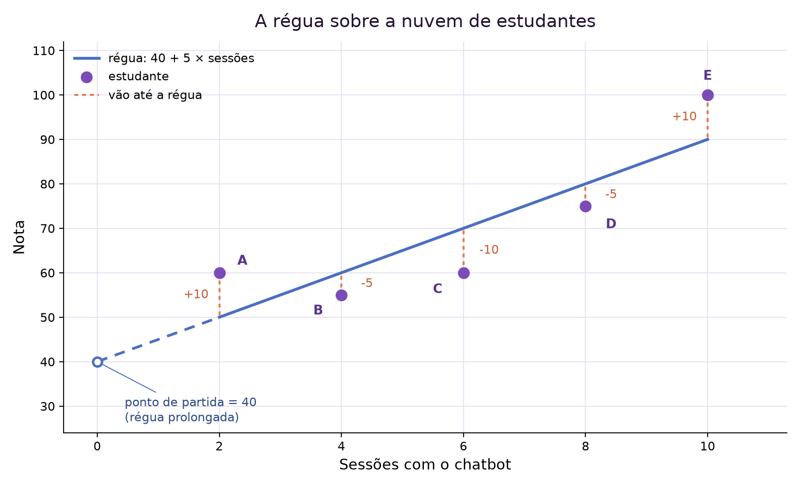
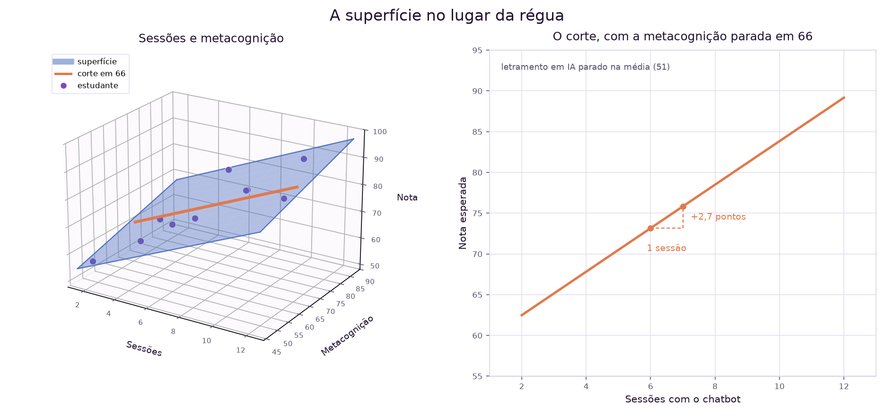

# Enc. 11 — Regressão Linear (simples e múltipla)

Estimar a nota com uma reta · `statsmodels.formula.api.ols()`
{: .fs-5 .fw-300 }

---

## 📊 Slides

<iframe src="https://math.rpmhub.dev/11regressao-linear/slides/index.html#/" title="Regressão Linear (simples e múltipla)" width="90%" height="500" style="border:none;"></iframe>

---

## 🍊 Metáfora

> **Imagine isso…**
>
> Uma professora quer saber, antes da prova, que nota esperar de cada estudante. Ela tem uma pista: o chatbot educacional da disciplina registra, nos logs, quantas sessões cada estudante abriu.
>
> Para descobrir como as sessões se relacionam com a nota, ela olha para uma turma do semestre anterior, que já fez a prova. Cada estudante dessa turma vira um ponto num gráfico: na horizontal, o número de sessões; na vertical, a nota.
>
> No geral, os pontos sobem da esquerda para a direita: quem abriu mais sessões costuma ter nota mais alta. Para resumir essa tendência numa linha só, a professora apoia uma régua transparente sobre o gráfico.
>
> Os pontos não estão perfeitamente alinhados, então nenhuma posição da régua passa por todos eles. Entre cada ponto e a régua sobra uma distância na vertical. Vamos chamar essa distância de **vão**: é o quanto a régua errou a nota daquele estudante.
>
> A professora vai ajustando a régua, inclinando mais ou menos e subindo ou descendo, até achar a posição em que os vãos, somados, ficam os menores possíveis. Nessa posição, a régua fica descrita por dois números:
>
> - o **ponto de partida**: a nota que a régua marca para quem tem zero sessões;
> - os **pontos por sessão**: quanto a régua sobe a cada sessão a mais.
>
> Com a régua posicionada, a professora volta para a turma atual, que ainda não fez a prova. Para cada estudante, basta ver quantas sessões ele abriu e ler na régua a nota esperada.
>
> Essa régua é a **regressão linear**.

**Como ler o gráfico.** Ele mostra uma turma fictícia de cinco estudantes, de A a E, com a régua já na melhor posição.

- Cada ponto roxo é um estudante. A, por exemplo, abriu 2 sessões e tirou 60.
- A linha azul é a régua. A regra dela é **nota esperada = 40 + 5 × sessões**: o ponto de partida é 40, e cada sessão a mais soma 5 pontos.
- Os traços laranja são os vãos. Para A, que abriu 2 sessões, a régua marca 40 + 5 × 2 = 50. Como A tirou 60, o vão de A é 60 − 50 = **+10**: a nota real ficou 10 pontos acima da régua.
- Um vão negativo quer dizer que a nota real ficou abaixo da régua. C abriu 6 sessões, a régua marca 70, e C tirou 60: o vão de C é **−10**.
- O trecho tracejado prolonga a régua até zero sessões, onde ela marca 40, o ponto de partida. Nenhum desses estudantes tem zero sessões: o 40 é só a altura da régua prolongada, não a nota de alguém.

De onde saem o 40 e o 5? De uma conta que aparece na seção 🧮 Fórmula e é feita à mão, estudante por estudante, na seção 🧩 Aplicação simples.

{: .highlight }
> **Como somar os vãos? Elevando cada um ao quadrado.** Somar os vãos do jeito que estão não funciona, porque os positivos cancelam os negativos. No gráfico, +10 − 5 − 10 − 5 + 10 = 0. A soma dá zero, como se a régua acertasse todo mundo, mas ela não acertou a nota de ninguém.
>
> A saída é elevar cada vão ao quadrado antes de somar. Assim todo vão vira um número positivo, e nada se cancela: 100 + 25 + 100 + 25 + 100 = 350. A melhor régua é a que deixa essa **soma dos vãos ao quadrado** a menor possível. Por isso o método se chama **mínimos quadrados**.
>
> O quadrado tem mais um efeito: ele pesa mais os vãos grandes. Um vão de 10 vira 100, enquanto dois vãos de 5 viram, juntos, 25 + 25 = 50. Para manter a soma pequena, a régua evita deixar qualquer estudante muito longe dela.
>
> Em textos técnicos, o vão se chama **resíduo**: a nota real menos a nota esperada.

> **Agora, um passo além…**
>
> A professora desconfia de uma coisa. Os estudantes que mais usam o chatbot também costumam ter mais **metacognição**: percebem melhor o que já sabem e o que ainda falta, e organizam o próprio estudo. Se for assim, parte dos pontos que a régua atribui às sessões pode vir, na verdade, da metacognição.
>
> Para separar uma coisa da outra, ela troca a pergunta. Em vez de "quantos pontos vale uma sessão a mais?", ela pergunta: **entre estudantes com a mesma metacognição, quantos pontos uma sessão a mais ainda acrescenta?** Ela também coloca na conta o **letramento em IA**: o quanto cada estudante já sabe usar ferramentas de inteligência artificial. Quem sabe usar IA tende a abrir mais sessões, então essa informação também pode estar misturada com as sessões.
>
> Com duas informações, como sessões e metacognição, a régua vira uma **superfície**: uma folha plana e inclinada num gráfico de três dimensões. Com três ou mais informações, a ideia é a mesma, mas o desenho não cabe mais no papel. Essa conta com várias informações ao mesmo tempo é a **regressão linear múltipla**.

Para essa parte, a metáfora usa outra turma fictícia, de 10 estudantes, que tem as três informações. Os dados estão na seção 📐 Várias informações ao mesmo tempo. As letras recomeçam em A: nessa turma, A abriu 2 sessões e tirou 57.

**Como ler a figura.** Ela tem dois painéis.

- **À esquerda**, cada ponto roxo é um estudante, posicionado pelas sessões, pela metacognição e pela nota. A folha azul é a superfície: ela dá a nota esperada para cada combinação de sessões e metacognição. A folha sobe nas duas direções, porque mais sessões e mais metacognição vêm com nota esperada mais alta.
- O desenho só tem três eixos: sessões, metacognição e nota. O letramento em IA não cabe nele, então fica fixo na média da turma, 51.
- A **linha laranja** é um corte da superfície com a metacognição fixa em 66, perto da média da turma. Ao longo dessa linha, só as sessões mudam.
- **À direita**, a mesma linha laranja vista de frente. De 6 para 7 sessões, a nota esperada sobe cerca de **2,7 pontos**. Esse é o valor de uma sessão a mais entre estudantes com a mesma metacognição e o mesmo letramento em IA.

Se a metacognição fosse fixada em outro valor, como 50 ou 80, a linha laranja ficaria mais baixa ou mais alta, mas teria a mesma inclinação. Por isso um único número, 2,7 pontos por sessão, resume o papel das sessões.

Nessa mesma turma, a régua que usa só as sessões dá cerca de **3,3 pontos por sessão**. A diferença entre 3,3 e 2,7 é a parte que a régua simples atribuía às sessões, mas que se explica pela metacognição e, em menor parte, pelo letramento em IA.

---

## 🎯 Para que serve

A régua e a superfície da metáfora são a regressão linear. Ela responde a perguntas como esta: **se um estudante fizer uma sessão a mais com o chatbot, quantos pontos a nota dele tende a subir? E que nota esperar de alguém que ainda não fez a prova?**

A resposta vem na forma de uma regra:

nota esperada = ponto de partida + pontos por sessão × número de sessões

- O **ponto de partida** é a nota que a regra estima para quem nunca abriu o chatbot (zero sessões).
- Os **pontos por sessão** dizem quanto a nota esperada sobe a cada sessão a mais.

A regressão é usada em duas etapas:

1. **Ajustar a regra.** Use estudantes que já têm as duas coisas registradas: o número de sessões e a nota. A conta encontra o ponto de partida e os pontos por sessão que deixam a régua o mais perto possível desses estudantes.
2. **Usar a regra.** Para um estudante que ainda vai fazer a prova, o log do chatbot já mostra quantas sessões ele abriu. Coloque esse número na regra, e o resultado é a nota esperada dele.

{: .highlight }
> **Que tipo de resposta a regressão linear estima?** Um número que pode assumir muitos valores ao longo de uma escala, como a nota de uma prova, os minutos numa sessão ou os acertos numa lista de exercícios. Em textos técnicos, esse número se chama **desfecho numérico contínuo** (ou variável dependente). Cada informação usada para estimá-lo, como as sessões, se chama **preditor** (ou variável independente).

**Onde este encontro se encaixa no curso:**

- **Correlação ou regressão.** A [correlação de Pearson](../02pearson/pearson.html) (encontro 2) mede se duas coisas sobem juntas, e com que força. A regressão vai um passo além: diz *quantos pontos* a nota sobe a cada sessão a mais e permite estimar a nota de alguém que ainda não está nos dados.
- **Simples ou múltipla.** Com uma informação só (as sessões), é a **regressão linear simples**. Com várias ao mesmo tempo (sessões, metacognição e letramento em IA), é a **regressão linear múltipla**. Na múltipla, o número de cada informação diz quantos pontos ela acrescenta entre estudantes iguais nas outras informações.
- **Quando a resposta não é um número numa escala, o método muda.** Para "engajou ou não engajou", use a [regressão logística](../12regressao-logistica/regressao-logistica.html). Para "quantas mensagens a pessoa enviou", use a [regressão de Poisson](../13poisson/poisson.html).

**As hipóteses.** Para cada informação colocada na regra, a regressão testa:

| | |
|:--|:--|
| **H₀** | Essa informação não ajuda a estimar a nota. Na população (todos os estudantes, não só os da amostra), os pontos que ela acrescenta são zero. |
| **H₁** | Essa informação ajuda a estimar a nota. Na população, os pontos que ela acrescenta são diferentes de zero, para mais ou para menos. |

O teste devolve um *p* para cada informação. O *p* responde: se H₀ fosse verdade, qual seria a chance de encontrar, só por acaso, um número tão longe de zero quanto o observado nos dados? Se *p* < 0,05, o corte usual, rejeita-se H₀.

{: .highlight }
> **A regra descreve o que vem junto. Ela não prova causa.** A regressão mostra que, nestes dados, mais sessões vêm acompanhadas de notas mais altas. Isso não quer dizer que o chatbot produziu a nota. Um estudante que já domina o conteúdo pode abrir mais sessões e, ao mesmo tempo, tirar nota alta por causa do que já sabia. Para afirmar causa, é preciso outro desenho de pesquisa, como um experimento em que os grupos são sorteados.

---

## 🧮 Fórmula

**Pontos por sessão.** A conta compara, estudante por estudante, o quanto as sessões e a nota se afastam das médias da turma:

<table style="border-collapse:collapse; font-family: Georgia, 'Times New Roman', serif; font-size:1.15em; margin:8px auto;">
<tr>
<td rowspan="2" style="padding-right:12px; vertical-align:middle;">pontos por sessão =</td>
<td style="text-align:center; padding:2px 12px; border-bottom:2px solid currentColor;">Σ (xᵢ − x̄)(yᵢ − ȳ)</td>
</tr>
<tr>
<td style="text-align:center; padding:2px 12px;">Σ (xᵢ − x̄)²</td>
</tr>
</table>

ponto de partida = ȳ − (pontos por sessão) × x̄

{: .highlight }
> **Lendo a fórmula:** *xᵢ* é o número de sessões do estudante *i*, e *yᵢ* é a nota dele. *x̄* e *ȳ* (lê-se "x barra" e "y barra") são a média das sessões e a média das notas. Assim, *xᵢ − x̄* é o quanto as sessões do estudante se afastam da média, e *yᵢ − ȳ* é o quanto a nota dele se afasta da média. Σ (a letra grega sigma) quer dizer "some o resultado de todos os estudantes".

**Por que essa conta funciona?** Olhe para o numerador, um estudante de cada vez:

- Quem tem mais sessões que a média *e* nota acima da média contribui com um produto positivo (positivo × positivo).
- Quem tem menos sessões que a média *e* nota abaixo da média também contribui com um produto positivo (negativo × negativo).
- Quem está acima da média numa coisa e abaixo na outra contribui com um produto negativo.

Se a soma dos produtos dá positiva, sessões e nota tendem a andar na mesma direção, e a régua sobe. Se dá negativa, a régua desce. O denominador mede o quanto as sessões variam na turma. Dividir por ele deixa o resultado na unidade que interessa: pontos de nota por sessão.

**Por que o ponto de partida é calculado assim?** A melhor régua sempre passa pelo ponto médio da turma: a média das sessões, na horizontal, e a média das notas, na vertical. Saindo desse ponto e voltando até zero sessões, a régua desce os pontos por sessão uma vez para cada sessão. Na turma da metáfora, a régua passa por 6 sessões e nota 70. Voltando 6 sessões até o zero, ela desce 5 × 6 = 30 pontos e chega a 70 − 30 = 40.

**R²: o quanto a régua ajuda a prever.** Para saber se a régua serve para alguma coisa, compare-a com a régua mais simples possível: uma régua horizontal na altura da nota média, que dá a mesma nota para todo mundo e ignora as sessões. O *R²* diz quanto a régua inclinada diminuiu a soma dos vãos ao quadrado em comparação com essa régua horizontal:

<table style="border-collapse:collapse; font-family: Georgia, 'Times New Roman', serif; font-size:1.15em; margin:8px auto;">
<tr>
<td rowspan="2" style="padding-right:12px; vertical-align:middle;"><em>R²</em> = 1 −</td>
<td style="text-align:center; padding:2px 12px; border-bottom:2px solid currentColor;">Σ (vão de cada estudante)²</td>
</tr>
<tr>
<td style="text-align:center; padding:2px 12px;">Σ (yᵢ − ȳ)²</td>
</tr>
</table>

- Em cima, a soma dos vãos ao quadrado da régua inclinada.
- Embaixo, a soma dos vãos ao quadrado da régua horizontal: a distância de cada nota até a nota média, ao quadrado.

*R²* perto de 1 significa que a régua inclinada acerta quase tudo o que a régua horizontal errava: as sessões ajudam muito a prever a nota. *R²* perto de 0 significa que a régua inclinada não é melhor do que dar a nota média para todo mundo: as notas variam por outros motivos.

---

## 🧩 Aplicação simples: a régua na mão

Vamos calcular a régua da metáfora com os cinco estudantes do gráfico. Aqui, *x* é o número de sessões e *y* é a nota final.

**Passo 1. Calcule as médias.**

- x̄ = (2 + 4 + 6 + 8 + 10) / 5 = 30 / 5 = **6** sessões.
- ȳ = (60 + 55 + 60 + 75 + 100) / 5 = 350 / 5 = **70** pontos.

**Passo 2. Calcule os afastamentos de cada estudante.** Subtraia as médias e faça os produtos e os quadrados:

| Estudante | xᵢ (sessões) | yᵢ (nota) | xᵢ − x̄ | yᵢ − ȳ | (xᵢ−x̄)(yᵢ−ȳ) | (xᵢ−x̄)² | (yᵢ−ȳ)² |
|:-:|:-:|:-:|:-:|:-:|:-:|:-:|:-:|
| A | 2 | 60 | −4 | −10 | 40 | 16 | 100 |
| B | 4 | 55 | −2 | −15 | 30 | 4 | 225 |
| C | 6 | 60 | 0 | −10 | 0 | 0 | 100 |
| D | 8 | 75 | 2 | 5 | 10 | 4 | 25 |
| E | 10 | 100 | 4 | 30 | 120 | 16 | 900 |
| **Soma** | | | 0 | 0 | **200** | **40** | **1350** |

Como ler uma linha: A abriu 2 sessões, 4 a menos que a média (2 − 6 = −4), e tirou 60, 10 pontos abaixo da média (60 − 70 = −10). Os dois afastamentos são negativos, então o produto é positivo: (−4) × (−10) = 40.

As colunas xᵢ − x̄ e yᵢ − ȳ sempre somam zero, porque o que fica acima da média compensa exatamente o que fica abaixo.

**Passo 3. Calcule os pontos por sessão.** Divida a soma dos produtos pela soma dos afastamentos das sessões ao quadrado: 200 / 40 = **5**.

**Passo 4. Calcule o ponto de partida.** Nota média menos pontos por sessão vezes a média das sessões: 70 − 5 × 6 = **40**.

**Passo 5. Escreva a regra:** nota esperada = 40 + 5 × sessões.

**Passo 6. Compare a régua com as notas reais.** A nota esperada sai da regra. O vão é a nota real menos a nota esperada.

| Estudante | Sessões | Nota real | Nota esperada | Vão |
|:-:|:-:|:-:|:-:|:-:|
| A | 2 | 60 | 40 + 5 × 2 = 50 | +10 |
| B | 4 | 55 | 40 + 5 × 4 = 60 | −5 |
| C | 6 | 60 | 40 + 5 × 6 = 70 | −10 |
| D | 8 | 75 | 40 + 5 × 8 = 80 | −5 |
| E | 10 | 100 | 40 + 5 × 10 = 90 | +10 |

**Passo 7. Calcule o *R²*.**

- Soma dos vãos ao quadrado da régua: 10² + (−5)² + (−10)² + (−5)² + 10² = 100 + 25 + 100 + 25 + 100 = **350**.
- Soma dos vãos ao quadrado da régua horizontal, na nota média 70: é a última coluna da tabela do passo 2, **1350**.
- *R²* = 1 − 350 / 1350 = 1000 / 1350 ≈ **0,74**.

Em palavras: com a régua horizontal, a soma dos vãos ao quadrado era 1350; com a régua inclinada, cai para 350. A régua inclinada eliminou 1000 dos 1350, cerca de 74%. Em textos técnicos, diz-se que as sessões explicam cerca de 74% da variação das notas nesta turma. "Explicar", aqui, quer dizer prever, e não causar. Os outros 26% continuam nos vãos.

{: .highlight }
> **Estimando a nota de um estudante novo.** Um estudante da turma atual abriu 7 sessões e ainda não fez a prova. Nota esperada = 40 + 5 × 7 = **75**. É uma estimativa, não uma garantia: assim como A, B, C, D e E, ele pode ficar acima ou abaixo da régua.

**E o *p*?** Ele exige uma conta mais longa, que o computador faz (veja o 🐍 Exemplo Python: uma informação só). Com estes 5 estudantes, o *p* dos pontos por sessão é **0,061**. A régua sobe de forma clara e o *R²* é alto, mas cinco estudantes são poucos. Como 0,061 é maior que 0,05, não dá para rejeitar H₀: com tão poucos dados, uma inclinação assim ainda poderia aparecer por acaso, mesmo que, na população, as sessões não tivessem relação com a nota.

---

## 🔢 O que significam os números da régua

| Número | Nome | O que significa nesta turma de 5 estudantes |
|:--|:--|:--|
| **40** | ponto de partida (intercepto, *b₀*) | A nota esperada para zero sessões. Ninguém desta turma tem zero sessões (o mínimo é 2), então o 40 vem da régua prolongada, não de um estudante observado. |
| **5** | pontos por sessão (inclinação, *b₁*) | A cada sessão a mais, a nota esperada sobe 5 pontos. |
| **0,74** | *R²* (coeficiente de determinação) | A régua reduz em cerca de 74% a soma dos vãos ao quadrado, em comparação com dar a nota média, 70, para todo mundo. |
| **0,061** | *p* dos pontos por sessão | Maior que 0,05: com só 5 estudantes, ainda não dá para generalizar a inclinação para além desta turma. |

O **sinal** dos pontos por sessão mostra a direção da régua. Positivo: mais sessões vêm com nota mais alta, e a régua sobe. Negativo: mais sessões viriam com nota mais baixa, e a régua desceria. Zero: a régua fica horizontal, e as sessões não ajudam a estimar a nota.

---

## 📐 Várias informações ao mesmo tempo

Esta é a turma da superfície da metáfora: 10 estudantes fictícios. Além das sessões, cada um tem mais duas informações:

- **metacognição:** um escore que mede o quanto o estudante percebe e organiza o próprio estudo;
- **letramento em IA:** um escore que mede o quanto o estudante já sabe usar ferramentas de inteligência artificial.

| Estudante | Nota | Sessões | Metacognição | Letramento em IA |
|:-:|:-:|:-:|:-:|:-:|
| A | 57 | 2 | 48 | 30 |
| B | 63 | 3 | 70 | 42 |
| C | 64 | 4 | 55 | 38 |
| D | 68 | 5 | 62 | 55 |
| E | 81 | 6 | 80 | 48 |
| F | 75 | 7 | 58 | 70 |
| G | 79 | 8 | 74 | 44 |
| H | 84 | 9 | 66 | 60 |
| I | 88 | 10 | 85 | 52 |
| J | 88 | 12 | 60 | 75 |

**Primeiro, a régua só com as sessões.** Nesta turma, ela dá cerca de **3,3 pontos por sessão**, com *R²* ≈ **0,90**. Essa conta, porém, não enxerga a metacognição nem o letramento em IA. E aqui quem abre mais sessões também tende a ter metacognição e letramento em IA mais altos. Então parte desses 3,3 pontos pode pertencer, na verdade, às outras duas informações.

**Depois, a regra com as três informações.** A regressão múltipla calcula um número para cada informação, todos ao mesmo tempo. Em números arredondados:

nota esperada ≈ 35 + 2,7 × sessões + 0,29 × metacognição + 0,06 × letramento em IA

Cada número compara estudantes que diferem só naquela informação e são iguais nas outras duas:

- **Sessões: cerca de 2,7 pontos por sessão** (*p* = 0,001). Entre estudantes com a mesma metacognição e o mesmo letramento em IA, uma sessão a mais vem com cerca de 2,7 pontos a mais na nota esperada. É a inclinação da linha laranja da metáfora. O valor caiu de 3,3 para 2,7 porque agora a conta separa o que acompanha as sessões do que acompanha a metacognição e o letramento.
- **Metacognição: cerca de 0,29 ponto por ponto de escore** (*p* = 0,016). Entre estudantes com as mesmas sessões e o mesmo letramento em IA, 10 pontos a mais de metacognição vêm com cerca de 2,9 pontos a mais na nota esperada.
- **Letramento em IA: cerca de 0,06 ponto por ponto de escore** (*p* = 0,58). Depois de levar em conta as sessões e a metacognição, o letramento em IA quase não muda a nota esperada. O *p* alto indica que esse valor pequeno pode ser só acaso.
- ***R²* ≈ 0,97.** Juntas, as três informações reduzem em cerca de 97% a soma dos vãos ao quadrado, em comparação com dar a nota média para todo mundo. Um *R²* tão alto é típico de exemplo de aula, com dados inventados. Numa turma real com só 10 estudantes, esses números oscilariam bastante de uma turma para outra.

**Usando a regra.** Para um estudante com 7 sessões, metacognição 60 e letramento em IA 50, a nota esperada é 35 + 2,7 × 7 + 0,29 × 60 + 0,06 × 50 = 35 + 18,9 + 17,4 + 3,0 ≈ **74**.

{: .highlight }
> **VIF: as informações andam juntas demais?** A regressão múltipla só consegue separar o papel de cada informação se elas não andarem sempre juntas. Imagine que todo estudante com muitas sessões também tivesse metacognição alta, e todo estudante com poucas sessões tivesse metacognição baixa. Aí a conta não teria como saber qual das duas acompanha a nota. O **VIF** (fator de inflação da variância) mede esse problema, uma informação de cada vez:
>
> - **VIF perto de 1:** a informação traz algo que as outras não trazem. A separação é tranquila.
> - **VIF acima de 5** (uma regra prática comum): a informação se repete demais nas outras. O número dela na regra fica instável e não deve ser lido sozinho.
>
> Nesta turma, os VIF ficam em cerca de **3,5** (sessões), **1,5** (metacognição) e **2,9** (letramento em IA), todos abaixo de 5. O maior é o das sessões, que andam bastante junto com o letramento em IA.

Em textos técnicos, o número de cada informação na regra se chama **coeficiente**, e o excesso de sobreposição entre informações se chama **multicolinearidade**.

---

## 📋 Quando usar

**Use a regressão linear quando:**

- ✅ A resposta que você quer estimar é um número numa escala: nota, minutos, acertos, um escore composto.
- ✅ No gráfico, a nuvem de pontos segue uma reta. Cada sessão a mais vem com um acréscimo parecido na nota, tanto de 2 para 3 sessões quanto de 9 para 10.
- ✅ Os vãos têm tamanho parecido ao longo de toda a régua. Eles não se abrem em leque, pequenos de um lado do gráfico e enormes do outro. Em textos técnicos, essa condição se chama **homocedasticidade**.

**Evite a regressão linear quando:**

- ❌ A resposta é "sim ou não", como engajou ou não engajou. Use a [regressão logística](../12regressao-logistica/regressao-logistica.html).
- ❌ A resposta é uma contagem de eventos, como quantas mensagens a pessoa enviou. Use a [regressão de Poisson](../13poisson/poisson.html). Atenção: o que define o método é a *resposta* que se quer estimar. As sessões também são uma contagem, mas aqui elas são a informação usada para estimar a nota, e isso não é problema.
- ❌ A nuvem de pontos faz uma curva. Por exemplo: muitas mensagens podem indicar confusão, e poucas mensagens podem indicar abandono, de modo que as notas mais altas ficam no meio. Uma régua reta passa por cima desse arco e não o acompanha.
- ❌ Duas informações andam juntas demais (VIF acima de 5). A conta roda, mas o número de cada uma na regra deixa de ter uma leitura confiável.
- ❌ Você quer concluir que o chatbot *causou* a nota. A regressão descreve o que vem junto e serve para estimar. Para afirmar causa, é preciso outro desenho de pesquisa.

---

## 🔍 Perguntas de pesquisa em Informática na Educação

Em pesquisas que analisam conversas de estudantes com um chatbot educacional, a regressão linear serve quando a resposta é um número numa escala e a nuvem de pontos segue uma reta. Alguns exemplos:

- Mais sessões com o chatbot vêm acompanhadas de nota final mais alta? Quantos pontos por sessão?
- O tempo total, em minutos, no chatbot ajuda a estimar quantos exercícios a pessoa acerta na semana?
- Entre estudantes com o mesmo escore de metacognição, uma sessão a mais ainda vem com pontos a mais na nota?
- O tamanho médio das mensagens do estudante ajuda a estimar a nota da atividade da semana?

{: .highlight }
> **Antes de ajustar a régua:** confirme que a resposta é um número numa escala, faça o gráfico e veja se a nuvem de pontos segue uma reta. Se a resposta for "sim ou não", ou uma contagem de mensagens, use outro método: a regressão logística ou a de Poisson.

---

## 🪜 Passo a passo na prática

1. **Faça o gráfico** de sessões × nota. Os pontos sobem em linha reta, fazem uma curva ou não mostram padrão nenhum?
2. **Ajuste a régua com uma informação só:** `nota ~ sessoes` (lê-se: nota em função das sessões).
3. **Se outras informações também podem estar ligadas à nota,** coloque-as na mesma conta: `nota ~ sessoes + metacognicao + letramento_ia`.
4. **Confira o VIF.** Acima de 5, duas informações andam juntas demais para separar o papel de cada uma.
5. **Leia os pontos e o *p* de cada informação.** Um *p* < 0,05 indica que um número tão longe de zero seria improvável se, na população, a informação não tivesse relação com a nota.
6. **Reporte** a regra (o ponto de partida e os pontos de cada informação), o *R²*, os valores de *p*, o número de estudantes e o gráfico. Use linguagem de associação, como "mais sessões vêm acompanhadas de notas mais altas", e não de causa, como "as sessões aumentam a nota".

---

## 📖 Como ler o resultado

**Turma de 5 estudantes.** A regra é nota esperada = 40 + 5 × sessões, com *R²* = 0,74 e *p* = 0,061. A régua descreve bem esses cinco estudantes, mas o *p* acima de 0,05 avisa que cinco pessoas não bastam para generalizar.

**Turma de 10 estudantes.** Leia primeiro as frases em português que o código imprime e só depois a tabela em inglês do `summary()`:

- **Só as sessões:** 3,29 pontos por sessão, *R²* = 0,90, *p* < 0,001. Cada sessão a mais vem com cerca de 3,3 pontos, mas essa conta ignora a metacognição e o letramento em IA.
- **Com as três informações:** cerca de 2,67 pontos por sessão (*p* = 0,001), 0,29 ponto por ponto de metacognição (*p* = 0,016) e 0,06 ponto por ponto de letramento em IA (*p* = 0,58). *R²* = 0,97.
- **VIF:** 3,49, 1,45 e 2,93, todos abaixo de 5. Dá para separar o papel de cada informação.

{: .highlight }
> **Traduzindo a tabela do `summary()`:**
>
> - `Intercept` é o ponto de partida.
> - A coluna `coef` traz o número de cada informação. Na linha `sessoes`, é quantos pontos a nota esperada sobe por sessão.
> - `P>|t|` é o *p* de cada informação.
> - `R-squared` é o *R²*.
> - `No. Observations` é o número de estudantes.
>
> O letramento em IA, com *p* = 0,58, continua na conta. Ele quase não muda a nota esperada desta turma, mas, por estar na conta, os pontos por sessão e por metacognição já descontam o papel dele.

---

## 🐍 Exemplo Python: uma informação só

**Contexto:** os mesmos 5 estudantes da conta à mão. A função `ols` calcula a régua pelo método dos mínimos quadrados, e o gráfico mostra os pontos com a régua por cima.

  

    🐍 Python executável no navegador via <a href="https://pyodide.org" target="_blank">Pyodide</a>
    <button type="button" class="run-btn">▶ Executar</button>
  

  <textarea class="code-input" spellcheck="false"></textarea>
  <pre class="code-output"></pre>

Ao executar, a saída deve mostrar ponto de partida = 40, pontos por sessão = 5, *R²* = 0,741 e *p* = 0,061, os mesmos valores da conta à mão. O gráfico mostra os cinco pontos e a régua subindo.

---

## 🐍 Exemplo Python: várias informações

**Contexto:** a turma de 10 estudantes. O código faz três coisas, nesta ordem: ajusta a régua só com as sessões; ajusta a regra com sessões, metacognição e letramento em IA, imprimindo a tabela completa do `summary()`; e calcula o VIF de cada informação.

Para o VIF, o código acrescenta uma coluna constante com `sm.add_constant`, que faz o papel do ponto de partida. Sem essa coluna, a versão do statsmodels que roda no navegador infla o VIF: nesta turma, os três valores passariam de 12, e pareceria haver um problema que não existe.

  

    🐍 Python executável no navegador via <a href="https://pyodide.org" target="_blank">Pyodide</a>
    <button type="button" class="run-btn">▶ Executar</button>
  

  <textarea class="code-input" spellcheck="false"></textarea>
  <pre class="code-output"></pre>

Compare os dois valores de pontos por sessão: cerca de 3,29 quando as sessões estão sozinhas na conta e cerca de 2,67 quando a metacognição e o letramento em IA entram junto. É a mesma diferença da metáfora, entre a régua e a superfície, agora calculada pelo computador.

---

## 📚 Referências

| | |
|:--|:--|
| **referência** | Hair, J. F., et al. (2019). *Multivariate Data Analysis* (8ª ed.). Cap. 4. |
| **didático** | James, G., et al. (2023). *An Introduction to Statistical Learning* (2ª ed.). Cap. 3. |
| **VIF** | O'Brien, R. M. (2007). A caution regarding rules of thumb for VIF. *Quality & Quantity, 41*, 673–690. |
| **python** | McKinney, W. (2022). *Python for Data Analysis*. |

## 🌐 Referências · Recursos na Web

| | |
|:--|:--|
| **livro aberto** | James, G., Witten, D., Hastie, T., & Tibshirani, R. [An Introduction to Statistical Learning](https://www.statlearning.com/). Cap. 3, PDF gratuito. A reta, o *R²* e a regressão com várias informações. |
| **web (EN)** | [OpenStax, *Introductory Statistics 2e*: 12.3 The Regression Equation](https://openstax.org/books/introductory-statistics-2e/pages/12-3-the-regression-equation). A equação da reta e a leitura do gráfico, com exemplos de sala de aula. |
| **documentação** | Statsmodels. [`ols`](https://www.statsmodels.org/stable/generated/statsmodels.formula.api.ols.html). A função usada nos exemplos em Python. |

---

 
<a rel="license" href="http://creativecommons.org/licenses/by/4.0/">CC BY 4.0 DEED</a>

