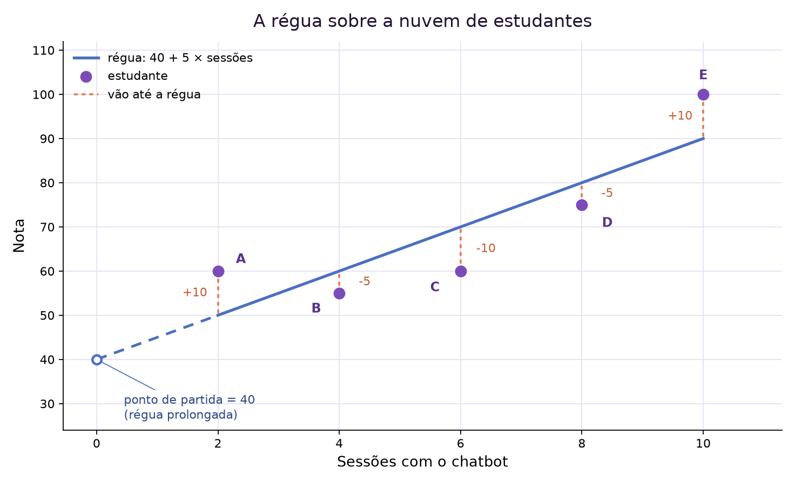
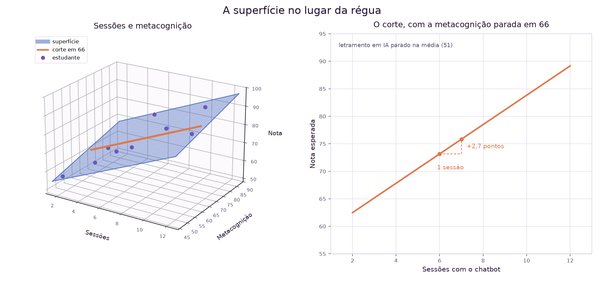

<!-- .slide: class="title-slide" -->

# Enc. 11

## Regressão Linear (simples e múltipla)

📈 Bloco 3 — Predição

<p class="small">Estimar a nota com uma reta · statsmodels.formula.api.ols()</p>

---

## 🍊 Metáfora

<p class="small">Uma professora quer saber, antes da prova, que nota esperar de cada estudante. A pista: as sessões que cada um abriu no chatbot.</p>

<p class="small">

- Ela usa uma turma do semestre anterior. Cada estudante vira um ponto: sessões na horizontal, nota na vertical.
- Apoia uma régua sobre o gráfico. Entre cada ponto e a régua sobra um **vão**: o quanto a régua errou a nota.
- Ajusta a régua até os vãos, somados, ficarem os menores possíveis.
- Ficam dois números: o **ponto de partida** (zero sessões) e os **pontos por sessão**.
- Na turma atual, basta ler na régua a nota esperada.

</p>

--

<center></center>

<div class="destaque">
A régua: nota esperada = 40 + 5 × sessões. O tracejado prolonga a régua até o ponto de partida, 40.<br>
A abriu 2 sessões: a régua marca 50 e A tirou 60, um vão de <strong>+10</strong>. C abriu 6: a régua marca 70 e C tirou 60, um vão de <strong>−10</strong>.
</div>

--

## 🍊 Como somar os vãos?

<p class="small">Somados como estão, eles se cancelam: +10 − 5 − 10 − 5 + 10 = 0. Parece que a régua acertou todo mundo, mas ela não acertou ninguém.</p>

<div class="destaque">
Elevando ao quadrado, nada se cancela: 100 + 25 + 100 + 25 + 100 = <strong>350</strong>. A melhor régua deixa essa soma a menor possível. Daí o nome <strong>mínimos quadrados</strong>.<br><br>
O quadrado pesa mais os vãos grandes: um vão de 10 vira 100, e dois vãos de 5 viram 50. Em textos técnicos, o vão se chama <strong>resíduo</strong>.
</div>

--

## 🍊 E se outras coisas também pesam?

<p class="small">Quem mais usa o chatbot também costuma ter mais <strong>metacognição</strong> (perceber e organizar o próprio estudo) e mais <strong>letramento em IA</strong>. Parte dos pontos que a régua atribui às sessões pode vir dessas outras informações.</p>

<div class="destaque">
A nova pergunta: entre estudantes com a mesma metacognição e o mesmo letramento em IA, quantos pontos uma sessão a mais ainda acrescenta?<br><br>
Com duas informações, a régua vira uma <strong>superfície</strong>. É a regressão linear múltipla.
</div>

--

<center></center>

<p class="small">Outra turma, de 10 estudantes. O letramento em IA fica fixo na média (51), e a linha laranja fixa a metacognição em 66. Nesse corte, de 6 para 7 sessões, a nota esperada sobe cerca de 2,7 pontos. Com a metacognição fixa em outro valor, a linha sobe ou desce, mas a inclinação não muda.</p>

---

## 🎯 Para que serve

<p class="small">Se um estudante fizer uma sessão a mais com o chatbot, quantos pontos a nota tende a subir? E que nota esperar de alguém que ainda não fez a prova?</p>

<center>nota esperada = ponto de partida + pontos por sessão × sessões</center>

<div class="destaque">
Duas etapas: <strong>ajustar</strong> a regra com quem já tem sessões e nota, e <strong>usar</strong> a regra com quem ainda vai fazer a prova.
</div>

--

<p class="small">

- O que se estima é um número numa escala: um **desfecho numérico contínuo**. A informação usada para estimá-lo, como as sessões, é o **preditor**.
- Pearson diz se duas coisas sobem juntas. A regressão diz quantos pontos por sessão.
- Uma informação só (as sessões): regressão linear simples. Várias ao mesmo tempo: regressão linear múltipla.
- "Engajou ou não": regressão logística. "Quantas mensagens": Poisson.

</p>

--

<div class="destaque">
<strong>H₀:</strong> essa informação não ajuda a estimar a nota (os pontos que ela acrescenta são zero).<br>
<strong>H₁:</strong> essa informação ajuda a estimar a nota (os pontos são diferentes de zero).
</div>

<p class="small">A regra descreve o que vem junto. Ela não prova causa: um estudante que já domina o conteúdo pode abrir mais sessões e, ao mesmo tempo, tirar nota alta por causa do que já sabia.</p>

---

## 🧮 Fórmula

<p class="small">Para cada estudante, o quanto as sessões (x) e a nota (y) se afastam das médias da turma.</p>

<center>
<table style="border-collapse:collapse; font-family: Georgia, 'Times New Roman', serif; font-size:1.05em; margin:8px auto;">
<tr>
<td rowspan="2" style="padding-right:12px; vertical-align:middle;">pontos por sessão =</td>
<td style="text-align:center; padding:2px 12px; border-bottom:2px solid currentColor;">Σ (xᵢ − x̄)(yᵢ − ȳ)</td>
</tr>
<tr>
<td style="text-align:center; padding:2px 12px;">Σ (xᵢ − x̄)²</td>
</tr>
</table>
</center>

<center>ponto de partida = ȳ − (pontos por sessão) × x̄</center>

<div class="destaque">
Afastamentos com o mesmo sinal dão produto positivo: sessões e nota andam juntas, e a régua sobe. A melhor régua sempre passa pelo ponto médio da turma (x̄, ȳ).
</div>

--

## 🧮 R²: o quanto a régua ajuda

<p class="small">Compare a régua com uma régua horizontal na nota média, que dá a mesma nota para todo mundo.</p>

<center>
<table style="border-collapse:collapse; font-family: Georgia, 'Times New Roman', serif; font-size:1.05em; margin:8px auto;">
<tr>
<td rowspan="2" style="padding-right:12px; vertical-align:middle;"><em>R²</em> = 1 −</td>
<td style="text-align:center; padding:2px 12px; border-bottom:2px solid currentColor;">Σ (vão de cada estudante)²</td>
</tr>
<tr>
<td style="text-align:center; padding:2px 12px;">Σ (yᵢ − ȳ)²</td>
</tr>
</table>
</center>

<div class="destaque">
Perto de 1: a régua inclinada acerta quase tudo o que a horizontal errava. Perto de 0: ela não é melhor do que dar a nota média para todo mundo.
</div>

---

## 🧩 Aplicação simples: a régua na mão

<p class="small">Médias: x̄ = 30 / 5 = 6 sessões e ȳ = 350 / 5 = 70 pontos.</p>

| Est. | Sessões | Nota | (xᵢ−x̄)(yᵢ−ȳ) | (xᵢ−x̄)² |
|:-:|:-:|:-:|:-:|:-:|
| A | 2 | 60 | 40 | 16 |
| B | 4 | 55 | 30 | 4 |
| C | 6 | 60 | 0 | 0 |
| D | 8 | 75 | 10 | 4 |
| E | 10 | 100 | 120 | 16 |
| **Soma** | | | **200** | **40** |

<div class="destaque">
Pontos por sessão = 200 / 40 = <strong>5</strong>. Ponto de partida = 70 − 5 × 6 = <strong>40</strong>.<br>
Nota esperada = 40 + 5 × sessões. Um estudante novo, com 7 sessões: <strong>75</strong>.
</div>

--

## 🧩 O vão de cada estudante

| Est. | Nota real | Nota esperada | Vão |
|:-:|:-:|:-:|:-:|
| A | 60 | 50 | +10 |
| B | 55 | 60 | −5 |
| C | 60 | 70 | −10 |
| D | 75 | 80 | −5 |
| E | 100 | 90 | +10 |

<div class="destaque">
Vãos ao quadrado: 350 com a régua, 1350 com a régua horizontal na média. <em>R²</em> = 1 − 350/1350 ≈ <strong>0,74</strong>: a régua elimina cerca de 74% dos vãos ao quadrado.
</div>

--

## 🧩 E o *p*?

<p class="small">Com 5 estudantes, o <em>p</em> dos pontos por sessão é <strong>0,061</strong>, acima do corte usual de 0,05.</p>

<div class="destaque">
A régua sobe de forma clara, mas cinco estudantes são poucos: ainda não dá para afirmar que, numa turma maior, as sessões acrescentariam pontos na nota.
</div>

---

## 🔢 O que significam os números da régua

- **40**, o ponto de partida: a nota esperada para zero sessões. Ninguém aqui teve zero sessões, então o 40 é a régua prolongada.
- **5**, os pontos por sessão: a cada sessão a mais, a nota esperada sobe 5 pontos.
- **0,74**, o *R²*: a régua elimina cerca de 74% dos vãos ao quadrado, comparada a dar 70 para todo mundo.
- **0,061**, o *p*: acima de 0,05, cinco estudantes não bastam para generalizar a inclinação.

<div class="destaque">
O sinal dos pontos por sessão dá a direção: positivo, a régua sobe; negativo, desceria; zero, as sessões não ajudam a estimar a nota.
</div>

---

## 📐 Várias informações ao mesmo tempo

<p class="small">Outra turma, de 10 estudantes, com metacognição e letramento em IA, além das sessões.</p>

<div class="destaque">
Só as sessões: cerca de <strong>3,3 pontos</strong> por sessão (<em>R²</em> ≈ 0,90). Essa conta não enxerga a metacognição nem o letramento em IA, e quem abre mais sessões tende a ter as duas mais altas.
</div>

--

<center>nota esperada ≈ 35 + 2,7 × sessões + 0,29 × metacognição + 0,06 × letramento em IA</center>

<p class="small">

- **Sessões:** cerca de 2,7 pontos (*p* = 0,001), entre estudantes com a mesma metacognição e letramento em IA.
- **Metacognição:** cerca de 0,29 ponto por ponto de escore (*p* = 0,016).
- **Letramento em IA:** cerca de 0,06 ponto (*p* = 0,58), quase não muda a nota aqui.
- ***R²*** ≈ **0,97**.

</p>

<div class="destaque">
O 3,3 cai para 2,7 porque a conta agora separa o que acompanha as sessões do que acompanha as outras duas informações.
</div>

--

## 📐 O aviso do VIF

<p class="small">A conta só separa o papel de cada informação se elas não andarem sempre juntas. VIF perto de 1: tranquilo. Acima de 5: a informação se repete demais nas outras, e o número dela fica instável.</p>

- Sessões: cerca de **3,5**
- Metacognição: cerca de **1,5**
- Letramento em IA: cerca de **2,9**

<div class="destaque">
Os três ficam abaixo de 5: dá para ler o papel de cada informação. Quando o VIF passa de 5, o nome técnico do problema é multicolinearidade.
</div>

---

## 📋 Quando usar

- ✅ A resposta é um número numa escala: nota, minutos, acertos.
- ✅ No gráfico, a nuvem de pontos segue uma reta.
- ✅ Os vãos têm tamanho parecido ao longo da régua (homocedasticidade). Eles não se abrem em leque.

--

## 📋 Evite quando

- ❌ A resposta é "sim ou não" (engajou ou não): regressão logística.
- ❌ A resposta é uma contagem, como quantas mensagens a pessoa enviou: Poisson. As sessões podem continuar como informação de entrada.
- ❌ A nuvem faz uma curva, em vez de uma reta.
- ❌ O VIF passa de 5: as informações andam juntas demais.
- ❌ Alguém quer concluir que o chatbot causou a nota.

---

## 🔍 Perguntas de pesquisa em Informática na Educação

- Mais sessões vêm acompanhadas de nota mais alta? Quantos pontos por sessão?
- Os minutos no chatbot ajudam a estimar quantos exercícios a pessoa acerta?
- Entre estudantes com a mesma metacognição, uma sessão a mais ainda vem com pontos a mais?
- O tamanho médio das mensagens ajuda a estimar a nota da atividade da semana?

---

## 🪜 Passo a passo na prática

<p class="small">

1. **Faça o gráfico** de sessões × nota.
2. **Ajuste a régua** com uma informação só: `nota ~ sessoes`.
3. **Se outras informações importam,** junte-as: `nota ~ sessoes + metacognicao + letramento_ia`.
4. **Confira o VIF.** Acima de 5, separe as informações antes de confiar nos números.
5. **Leia os pontos e o *p*** de cada informação.
6. **Reporte** a regra, o *R²*, os *p*, o número de estudantes, e use linguagem de associação, não de causa.

</p>

---

## 📖 Como ler o resultado

- **5 estudantes:** 40 + 5 × sessões, *R²* = 0,74, *p* = 0,061.
- **10, só sessões:** cerca de 3,3 pontos por sessão, *R²* = 0,90.
- **10, três informações:** 2,7 por sessão (*p* = 0,001), 0,29 por ponto de metacognição (*p* = 0,016), 0,06 por ponto de letramento em IA (*p* = 0,58).

<div class="destaque">
Na tabela em inglês do <code>summary()</code>: <code>Intercept</code> é o ponto de partida, <code>coef</code> é o número de cada informação, <code>P&gt;|t|</code> é o <em>p</em>, <code>R-squared</code> é o <em>R²</em>.
</div>

---

## 🐍 Exemplo Python: uma informação só

```python
modelo = smf.ols('nota ~ sessoes', data=df).fit()
print(f"Ponto de partida = {modelo.params['Intercept']:.1f}")
print(f"Pontos por sessão = {modelo.params['sessoes']:.1f}")
print(f"R² = {modelo.rsquared:.3f}")
```

<div class="destaque">
Código <strong>executável</strong> na página do encontro. Roda nos 5 estudantes e desenha a régua por cima dos pontos.
</div>

--

## 🐍 Exemplo Python: várias informações

```python
X = sm.add_constant(df[['sessoes', 'metacognicao', 'letramento_ia']])
vif = [variance_inflation_factor(X.values, i)
       for i in range(1, X.shape[1])]
```

<div class="destaque">
Ajusta a régua só com sessões, depois com as três informações, e calcula o VIF. A constante (<code>add_constant</code>) evita que o VIF saia inflado no navegador.
</div>

---

## 📚 Referências

- **referência:** Hair et al. (2019). *Multivariate Data Analysis* (8ª ed.). Cap. 4.
- **didático:** James et al. (2023). *An Introduction to Statistical Learning* (2ª ed.). Cap. 3. PDF gratuito em [statlearning.com](https://www.statlearning.com/).
- **VIF:** O'Brien (2007). *Quality & Quantity, 41*, 673–690.
- **python:** McKinney (2022). *Python for Data Analysis*.
- **aula aberta:** [OpenStax, 12.3 The Regression Equation](https://openstax.org/books/introductory-statistics-2e/pages/12-3-the-regression-equation).

---

## 🔗 Materiais

[Conteúdo completo + código executável](../regressao-linear.html)

[math.rpmhub.dev](https://math.rpmhub.dev)
